# Thermoacoustic Phenomena in a Heat Exchanger

An illustrative, multi-language project on thermoacoustic instability in a heat exchanger. It covers the physics model, 3D visualisation, data cleaning, machine learning, deep learning, Navier-Stokes checks, thermodynamics and heat transfer, and dimensionless numbers, implemented in Python, C, C++, C#/.NET, Bash and TypeScript.

> **Scope:** this is a toy model for teaching and exploration. It is not a validated design tool.

---

## Project at a glance

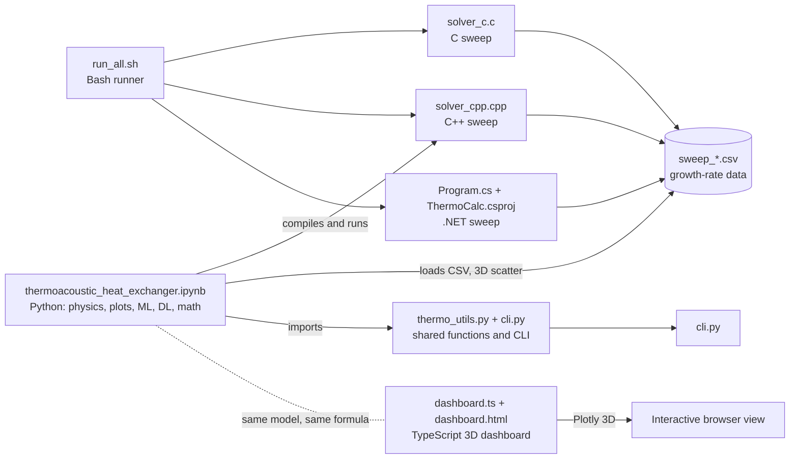

## Physics model

The toy model combines acoustic modes of a closed-open duct with a Rayleigh-type drive. A mode grows when the heat release is in phase with the pressure oscillation.

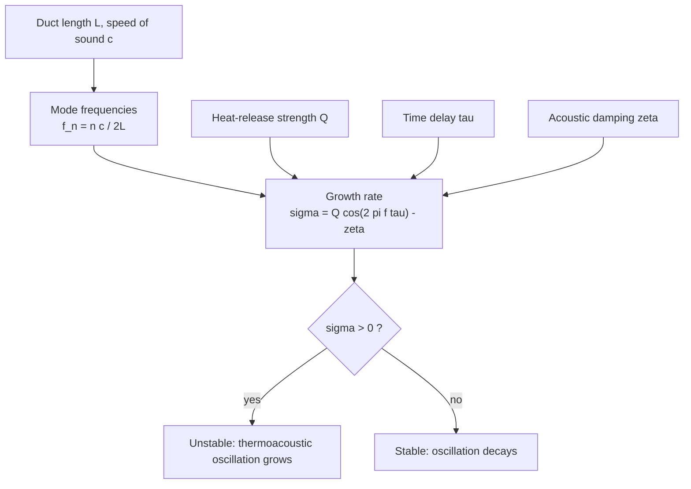

## Notebook map

The main notebook has 22 sections. Each section can be run on its own after the setup cell.

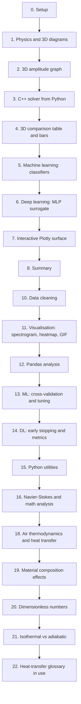

## Heat-transfer concepts

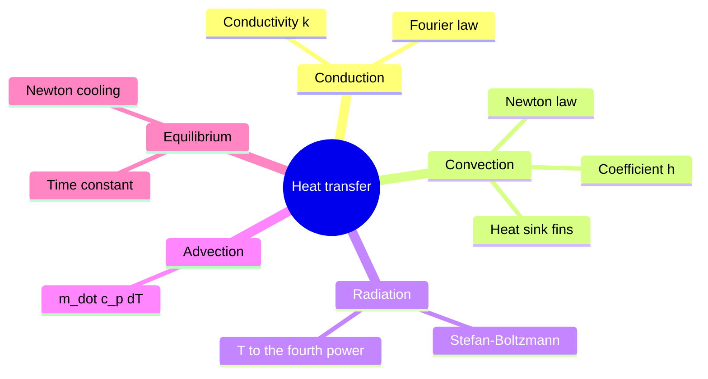

## Language support

| Language | File | How to run |
|---|---|---|
| Python | `thermoacoustic_heat_exchanger.ipynb`, `thermo_utils.py`, `cli.py` | `jupyter notebook` or `python cli.py --mode 2 --tau 0.003 --Q 1.2` |
| C | `solver_c.c` | `gcc -O2 -std=c99 solver_c.c -o solver_c -lm && ./solver_c > sweep_c.csv` |
| C++ | `solver_cpp.cpp` | `g++ -O2 -std=c++17 solver_cpp.cpp -o solver_cpp && ./solver_cpp > sweep_cpp.csv` |
| C# / .NET | `Program.cs`, `ThermoCalc.csproj` | `dotnet run --project ThermoCalc.csproj > sweep_dotnet.csv` |
| Bash | `run_all.sh` | `bash run_all.sh` (builds all solvers and checks outputs) |
| TypeScript | `dashboard.ts`, `tsconfig.json`, `package.json` | `npm install && npm run build`, then open `dashboard.html` |

### How the solvers relate

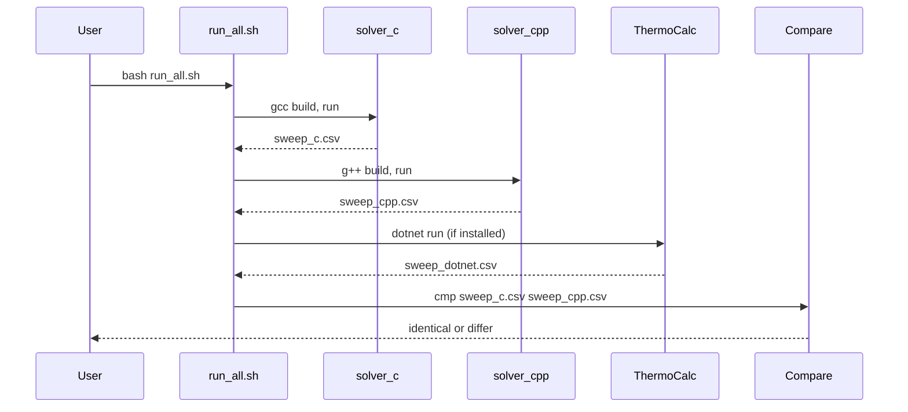

## Setup

Python:
```bash
pip install -r requirements.txt
jupyter notebook thermoacoustic_heat_exchanger.ipynb
```

Run the notebook from the project folder so its relative paths resolve.

Native solvers and the Bash runner:
```bash
bash run_all.sh
```

TypeScript dashboard:
```bash
npm install
npm run build
# then open dashboard.html in a browser
```

## Files

| File | Purpose |
|---|---|
| `thermoacoustic_heat_exchanger.ipynb` | Main notebook, all sections merged |
| `thermo_utils.py` | Shared Python functions |
| `cli.py` | Command-line growth-rate calculator |
| `solver_c.c` | C solver |
| `solver_cpp.cpp` | C++ solver |
| `Program.cs`, `ThermoCalc.csproj` | .NET solver |
| `run_all.sh` | Bash runner for all solvers |
| `dashboard.ts`, `dashboard.html`, `tsconfig.json`, `package.json` | TypeScript 3D dashboard |
| `GLOSSARY.md` | Heat-transfer terms |
| `requirements.txt` | Python dependencies |
| `.gitignore` | Ignores build outputs and caches |
| `LICENSE` | MIT |

## Results gallery

All 29 figures are generated by the notebook and saved here as PNG files. Each one is also stored in the notebook's cell outputs.

### Physics and 3D diagrams (sections 1-4)

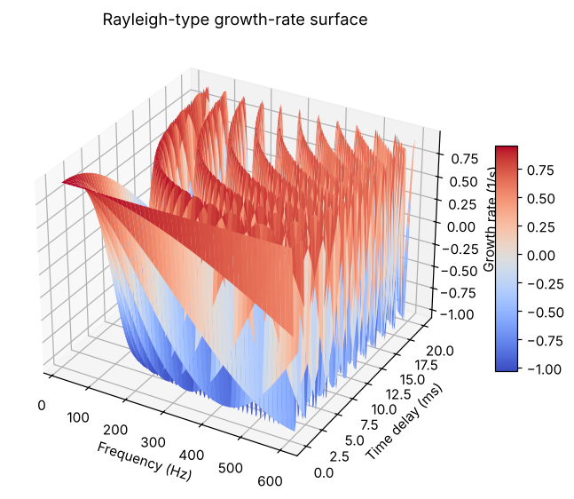
*Rayleigh-type growth-rate surface over frequency and time delay (section 1).*

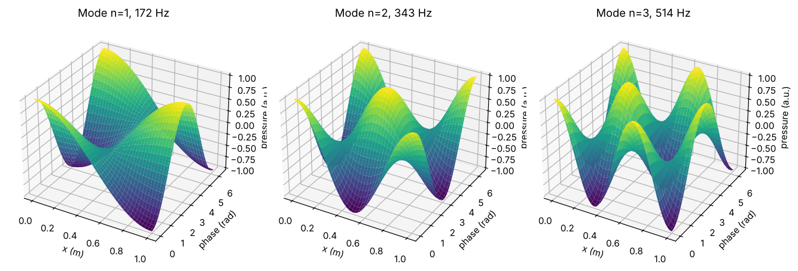
*Acoustic mode shapes for n = 1, 2, 3 (section 1).*

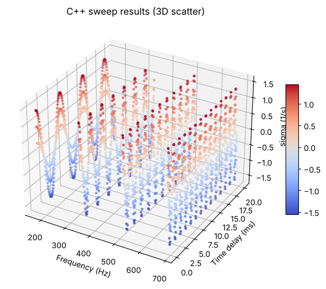
*3D scatter of the C++ solver output (section 3).*

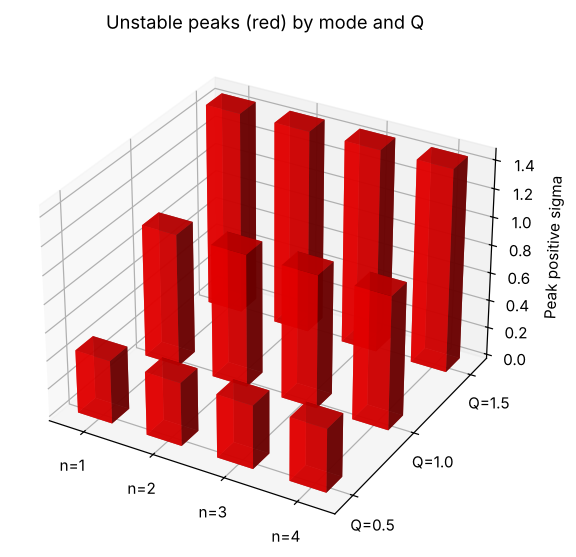
*3D bar chart of peak growth rate by mode and heat release (section 4).*

### Machine learning and deep learning (sections 5-14)

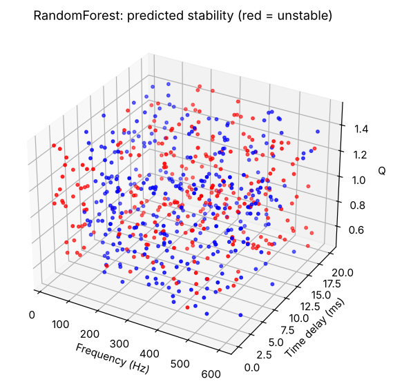
*Stable vs unstable prediction on the test set (section 5).*

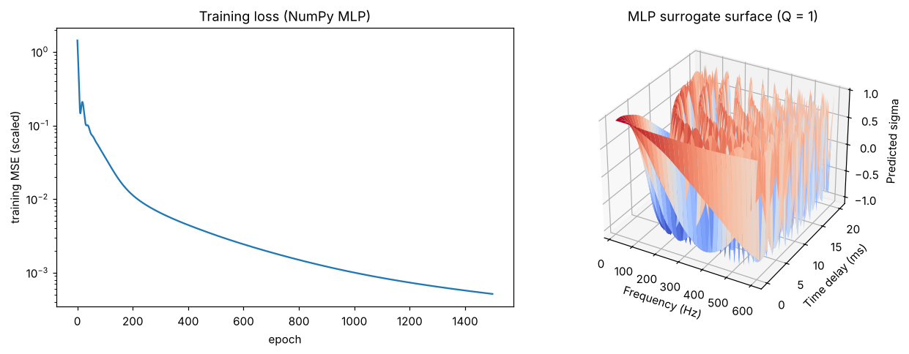
*MLP surrogate surface for the growth rate (section 6).*

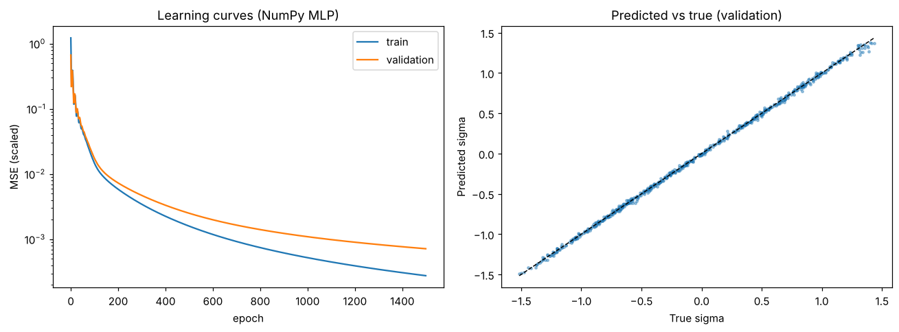
*Learning curves and predicted vs true values for the validation set (section 14).*

### Mathematics and thermodynamics (sections 16-22)

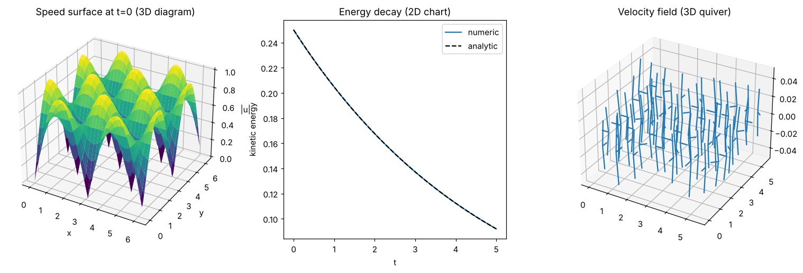
*Taylor-Green vortex, an exact 2D Navier-Stokes solution: speed surface, kinetic-energy decay and velocity field (section 16).*

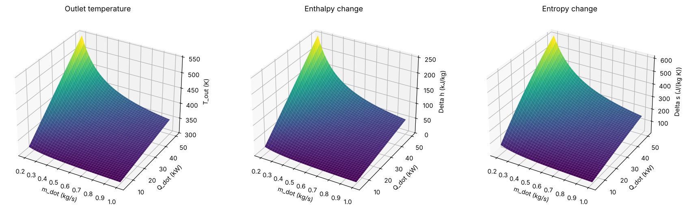
*Outlet temperature, enthalpy change and entropy change for heated air (section 18).*

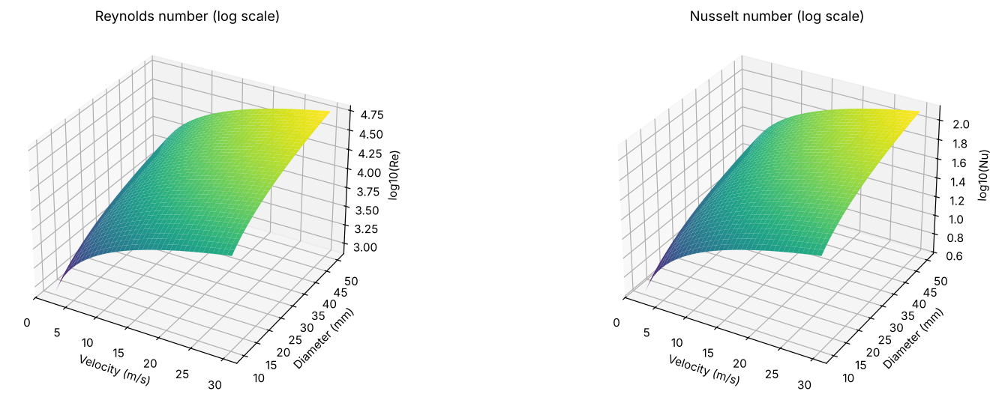
*Reynolds and Nusselt numbers against velocity and tube diameter, on a log scale (section 20).*

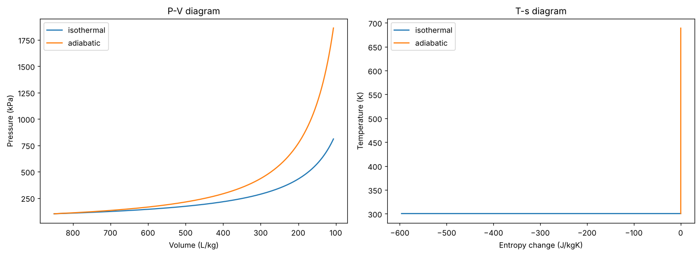
*Isothermal vs adiabatic compression: P-V and T-s diagrams (section 21).*

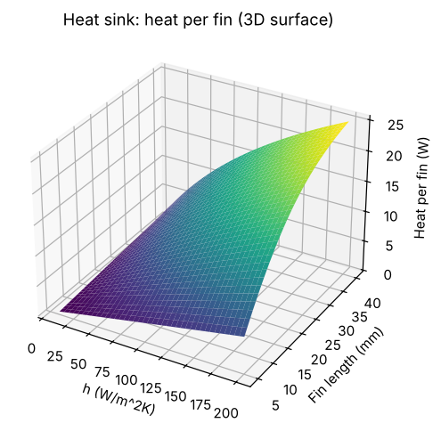
*Heat per fin against convective coefficient and fin length (section 22).*

## Important notes

- **Toy model:** the growth-rate model is simplified. The material-composition parameters are illustrative, not measured.
- **Navier-Stokes:** existence and smoothness of 3D solutions is an open problem (Clay Millennium Prize). The notebook checks an exact 2D solution and does not claim a new theorem.
- **Correlations:** the Nusselt correlation (Dittus-Boelter) is for turbulent flow, Re above 10,000. Values at lower Reynolds numbers are only indicative.
- **Verification status:** all 47 code cells of the notebook were executed in this environment, and the results are saved in the notebook. PyTorch and IPython could not be installed here, so the deep learning sections (6 and 14) ran on a NumPy MLP fallback with physics-informed phase features. Running the notebook with PyTorch will use the PyTorch path instead. The .NET and TypeScript builds were not compiled here.


## Licence

MIT. See `LICENSE`.
